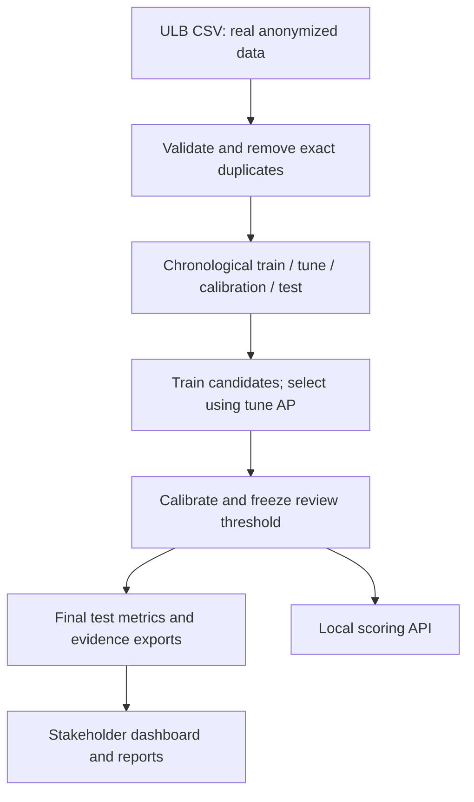

# FraudShield implementation contract

Status: real card transaction research plus a separate measured synthetic account-opening assurance study. Online payments and current institution-specific validation remain unmeasured. See assurance_design.md and bank_data_contract.md for the extension.

## Flow

## Data contracts

`fraudshield.data.load_card(path)` returns a time-sorted pandas frame and source metadata. Required columns are numeric `Time`, `Amount`, `V1`–`V28`, and binary `Class` with both classes present. All features must be finite, `Time` and `Amount` non-negative. Exact duplicate rows are removed; stable sorting preserves original order for tied timestamps. New identifiers `ULB-000000` onward describe sorted retained row positions, not actual account identities. The source file SHA-256 is captured.

`model_input(frame)` validates required raw features, replaces Amount with `LogAmount = log1p(Amount)`, and returns V1–V28 followed by LogAmount. Absolute Time and Class are never model inputs. It performs no statistical fitting.

`temporal_splits(frame)` computes Time quantiles at 0.50, 0.65 and 0.80. Values equal to a boundary remain in the earlier partition (`searchsorted(..., side='left')`). Each period needs at least 100 rows and both classes; otherwise training fails clearly. Partition time ranges must be strictly separated. Quantile boundaries use timestamps only, not labels. Real label availability delays cannot be reconstructed from this dataset.

## Training and selection

`fraudshield.training.train(data_path, root, bootstrap_repeats=150)` runs a bounded, predeclared search. Four training threads and seed 42 are used. Candidates: dummy prevalence (1 configuration), scaled class-weighted logistic regression (2 C values), random forest (1), Extra Trees (1), histogram gradient boosting (2 class-weight variants), isolation forest (1), LightGBM (3 leaf/weight variants), XGBoost (2 positive-weight variants). The exact estimator representations and tune AP for all trials are exported in `run.trials`. Optional LightGBM/XGBoost import failures print a skip message. Other training failures stop the run instead of fabricating results.

Every candidate fits only on training data; isolation forest does not access training labels. Configuration selection within each family uses raw-score tune AP. The champion is the highest raw-score tune AP across non-dummy families. It is not chosen by test performance.

For each winning configuration, raw supervised probabilities become clipped logits (epsilon 10^-8); anomaly scores are negative decision-function values. StandardScaler followed by L2 logistic regression (`C=1`) fits a sigmoid using calibration labels only. This is separate from original model fitting. The calibration period has 49 frauds in the measured dataset, so calibrated probabilities remain uncertain. The fixed threshold is the kth largest calibration probability, with k=ceil(1% × calibration size). Equal scores can exceed that review budget; actual counts are shown. Training and serving share `predict_bundle`.

## Metrics

`operating_metrics(y, scores, amounts, threshold)` reports TP, FP, FN, TN, alerts, precision, recall, FPR, alert rate, flagged fraud amount and missed fraud amount. A score equal to threshold is flagged. Empty/alignment and finite-input errors fail explicitly; zero denominators are treated as zero-rate results.

`evaluate` reports average precision, ROC-AUC, Brier score, top 0.5% and 1% ranking precision/recall, descriptive recall at FPR <=0.001, confusion counts at the frozen threshold, display curves and calibration bins. AP is step-weighted, not trapezoidal PR area. Top-k ties are broken by stable row order without using labels. Recall at an FPR is a retrospective curve statistic, not a deployed threshold.

`block_bootstrap_ap` partitions the ordered test period into 40 contiguous blocks, resamples blocks with replacement 150 times by default, skips one-class replicates and takes 2.5/97.5 percentiles. This is conditional on the fitted model and limited short observation period. No significance claim between models is made.

Latency is measured in 12 local repetitions after one warmup on a 256-row batch. Includes input validation, transformation, model inference and calibration; excludes disk/network. Training seconds include all configurations tried in the family. Global permutation importance uses the champion, a seed-fixed at-most-15,000-row tune subset, raw-score AP and 3 repeats. PSI uses train decile edges with infinite tails and a 10^-6 frequency floor; constant training features return zero PSI.

## Outputs

- `artifacts/model-N.joblib`: locally trusted dictionary with estimator, calibrator, anomaly flag, features, model name and frozen threshold.
- `artifacts/model_hashes.json`: SHA-256 per serialized model. Integrity check is not an authenticity guarantee.
- `artifacts/run.json`: run ID, schema version, dataset metadata, splits, model metrics, selection rule, trials, feature importance, PSI, environment versions, hashes of engine Python sources, protocol, limitations and roadmap.
- `artifacts/trials.csv`: one row per tried configuration.
- `web/benchmark.json`: `{run, transactions, case_features}`. Transactions are parallel arrays `id,time,amount,label,scores`; scores is a map from model ID to probability arrays. Features are exported for the highest-scored 35 test cases per model only.
- `web/model_metrics.csv`: scalar metrics; nested details are in run JSON.
- `web/report.html`: printable report, generated from measured results.

JSON serialization rejects non-finite values. `benchmark.json` is replaced using a temporary sibling file. Other generated outputs are written individually; do not train while serving or publishing a benchmark. This version has no multi-file transactional run store or concurrent-training support. Run one training job at a time and publish only after successful completion.

## Local API

`python run.py serve [--port 8765]` loads the champion once, verifies its recorded model hash, and binds `127.0.0.1`. Only exact `localhost:PORT` or `127.0.0.1:PORT` Host values are accepted for GET, HEAD and POST. Scoring POST requests with an Origin must match the HTTP local origin; static GET/HEAD do not require Origin. This mitigates cross-origin writes and DNS rebinding; it is not multi-user authentication.

- `GET /api/health`: ready, model name, run ID, max_rows=500.
- `POST /api/score`: Content-Type application/json, Content-Length 1–1,000,000, exactly `{"transactions": [...]}`. Accepts 1–500 objects. Only V1–V28, Amount and optional Time are accepted. Strings, booleans, null, missing required features, non-finite values and negative Amount are rejected. A lock serializes inference calls.
- Success: model, run_id, threshold, results (zero-based row, risk_probability, review), warning.
- Errors: JSON 400 validation/parse error; 403 bad Host/Origin; 404 unknown POST route; 413 invalid body length; 415 unsupported media type. Static missing files use standard HTTP errors.

Only `web/` is served. Directory listings are disabled. Model and raw data directories are not under that root. Scoring inputs are not persisted; standard HTTP request paths/status are logged. Research review dispositions are persisted only in local run-scoped SQLite (see extension contract below). No user authentication, TLS, fraud blocking, queue, or production incident response is implemented.

## Dashboard contract

Seven views: decision overview, model laboratory, case explorer, data and reliability, local scoring, reports, and evidence/safeguards. Hash navigation works without a router dependency. No external JavaScript, font or chart CDN is required. Browser cost and threshold exploration is retrospective only. Changing tabs preserves the chosen model, cost assumptions, policy mode and review budget. Browser reload resets scenario state.

The static hosted dashboard can explore measured results and export reports without a server. New scoring requires the local Python API, and the interface states when it is unavailable. Do not present static hosting as a deployed inference backend.

## Verification

Run `python -m pytest -q`, `node --check web/app.js` and `node tests/test_dashboard.cjs`. HTTP handler tests use an in-memory connection with a small estimator because the execution sandbox blocks outgoing loopback connections. They exercise the real HTTP parser and handler but are not a live-network end-to-end test. Exported evidence checks run when the measured payload is present. Browser verification and independent findings are recorded in `docs/review.md`.

## Detailed reproducibility contracts

Explicit search overrides (remaining installed-library defaults are captured recursively, including nested pipeline estimators, in each trial's `estimator_spec` along with exact package versions):

Nonfinite library defaults such as XGBoost's missing-value sentinel are encoded as `{"special_float":"nan"}` (or `inf`/`-inf`) in estimator specifications, rather than emitting invalid JSON numbers. This describes library configuration, not missing observations in the accepted dataset.

| Family | Configuration overrides |
| --- | --- |
| Prevalence | DummyClassifier(strategy=prior) |
| Logistic | StandardScaler; LogisticRegression C in [0.1, 1.0], class_weight=balanced, max_iter=700, seed 42 |
| Random forest | 140 trees, depth 14, min leaf 3, balanced_subsample weights, max_samples 0.7, n_jobs 4, seed 42 |
| Extra Trees | 160 trees, depth 18, min leaf 3, balanced weights, n_jobs 4, seed 42 |
| Histogram boosting | 180 iterations, 15 leaves, learning rate 0.06, L2 2, class_weight in [None, balanced], early_stopping false, seed 42 |
| Isolation forest | 160 trees, max_samples 2048, n_jobs 4, seed 42 |
| LightGBM | 350 estimators, (leaves, class_weight) in [(15,None),(15,balanced),(31,None)], learning rate 0.04, min_child_samples 40, reg_lambda 2, verbosity -1, n_jobs 4, seed 42 |
| XGBoost | 300 estimators, depth 4, learning rate 0.05, min_child_weight 5, reg_lambda 3, subsample 0.85, colsample_bytree 0.9, scale_pos_weight in [1,20], tree_method hist, eval_metric logloss, n_jobs 4, seed 42 |

If every bootstrap replicate has one class, the interval is `[null, null]`. `ap_ci95` is a two-element array. `top_1pct` and `top_05pct` each contain `k`, `precision` and `recall`. `operating` contains `tp, fp, fn, tn, alerts, precision, recall, fpr, alert_rate, captured_exposure, missed_exposure`. `pr_curve` stores `[recall, precision]` points, `roc_curve` stores `[fpr, tpr]` points; each uses up to 180 evenly spaced index positions including endpoints of the full sklearn curve. Calibration bins use unique score quantiles at 0,0.1,...,1; intervals are left inclusive, right exclusive except the final interval. Empty bins are skipped. Each bin has `predicted, observed, n`. A constant-score model produces one bin covering every observation. `calibrator_standardized_coefficient` is the sigmoid coefficient on standardized transformed raw scores, not a held-out calibration diagnostic slope.

Browser defaults: champion model; frozen threshold mode; exploratory budget 1%; recovery 50%; review cost EUR 3. Budget slider range 0.1–5% in 0.1-point steps; top-k uses `max(1,ceil(n*budget/100))` with stable index ties. Recovery range 0–100%; review-cost range EUR 0–1000. Invalid numeric edits show a message and retain prior values. Illustrative net benefit is `flagged historical fraud Amount * recovery / 100 - alerts * review cost`, versus no review/recovery; it is not realized savings.

Case filters are alerted, all, historical fraud, and missed fraud. Search matches generated ID case-insensitively or the raw amount string. Risk sorts descending with index tie breaks; 25 rows per page. CSV case export includes all filtered rows, with headers `transaction_id,elapsed_seconds,amount_eur,risk_probability,review,historical_label`. Scenario HTML contains a printable JSON record of run ID, dataset hash, model, operating rule, assumptions, outcomes, illustrative net benefit and limitations. All budget/cost scenarios retain their retrospective designation.

CSV scoring inputs are limited to 1 MB and 500 rows. The parser handles quoted fields, escaped double quotes, CRLF, blank rows and UTF-8 BOM; rejects unclosed quotes, duplicate headers, inconsistent widths and empty/nonfinite numeric fields. Server validation is authoritative. Scoring JSON input, error and results persist across view navigation during the browser session; async completions do not dereference removed views. Skip-to-main focuses the main element without changing the hash route. Model-family labels use the actual exported model count.

## Assurance extension contracts

`assurance.py` adds `group_audit` (binary labels, scores, supplied groups, common threshold, minimum 30 positive and 30 negative examples for gap inclusion), `comparison_gate` (all ten declared protocol fields must be present and equal), `cluster_ap_interval` (default 300 resamples, seed 42, at least 20 supplied clusters and at least max(20,repeats/2) valid two-class resamples), and `financial_outcomes` (observed closed outcomes, Decimal arithmetic, separate currencies). Small group results remain visible even when excluded from gaps. Wilson intervals are descriptive under independent-record assumptions. Comparison matches are asserted compatibility, not independent verification. No robust AP interval is produced when cluster evidence is insufficient. `bank_events.py` implements the separately documented bank data contract and maturity/point-in-time validation only; it does not fit a current-bank model.

`baf.run_baf` uses the exact original 32-column schema and fixed feature order. It rejects extra or missing columns, nulls, duplicate rows and missing source months. Predictors exclude fraud_bool, month, customer_age and device_fraud_count. Unknown tree categories map to -1 using training-only category maps; linear models use training-fitted numeric scaling and sparse one-hot encoding. Three estimators are predeclared for each fold: scaled/one-hot class-balanced logistic regression (C1, max_iter600), and LightGBM with/without class balancing (250 estimators, 15 leaves, learning rate .05, min_child_samples80, reg_lambda3, four threads, seed42). For test months 5/6/7, train <=test-3, tune=test-2, calibration=test-1. Champion selection uses earlier raw tune AP. Sigmoid calibration uses only the independent earlier calibration month; threshold targets 5% calibration reviews. Exact estimator specifications and all measured fold metrics are exported. No label-delay or entity-aware evaluation is claimed for BAF; supplied synthetic aggregate features retain unknown upstream provenance.

BAF audit groups are source customer_age <50 and >=50, at one common saved threshold. TreeSHAP uses the unweighted LightGBM challenger even if another estimator is champion; examples identify that model. All-feature contribution sums are checked against raw margin within 1e-6. Top-six contributions are display-only; they are neither causal reasons nor calibrated probability decompositions. The measured account-opening evidence stays separate in web/assurance.json and artifacts/baf/. The BAF-derived model/reports/examples are noncommercial/share-alike research artifacts; see DATA_ATTRIBUTION.md.

Local reviews use `ReviewStore(path,dataset_sha256,run_id)`. Context fields are required, included in every hashed record and checked against stored context. `serve` uses `local-state/reviews/DATASET_SHA256/RUN_ID.sqlite`, preventing positional ULB IDs from silently inheriting reviews from another dataset or run. Accepted dispositions: cleared_for_study, escalate_for_review, inconclusive. Actor is a 3–40-character pseudonym of letters/digits/underscore/hyphen; reason is 5–500 printable characters (newline/tab allowed). The API also verifies the event ID exists in the current held-out study. No criminal finding or payment action occurs.

`GET /api/reviews?event_id=...` returns events and local hash-chain verification. `POST /api/reviews` accepts exactly event_id/actor/disposition/reason and returns 201 with the appended event. Unknown IDs or invalid content return 400; unavailable review store returns 503. The same Host, Origin, JSON and body-limit controls as scoring apply to review POST. SQLite BEGIN IMMEDIATE serializes append transactions. SQL triggers reject UPDATE/DELETE through this store; a SHA-256 chain detects record changes locally, but does not authenticate reviewers or prevent an owner from replacing the database. Integrity failure prevents startup/append. Browser dialog generations and per-dialog pending-state guards prevent stale callbacks from editing another dialog or enabling duplicate submissions.

`finalize_assurance.py` adds source/license attribution, separate extension source hashes and the original ULB elapsed-day cluster guard, then generates a printable eight-limit report. Original ULB metrics and original training-source hashes are preserved as historical evidence. The original arbitrary fixed-block AP intervals are explicitly exploratory, not dependence-supported confidence claims. `package_delivery.py` embeds both evidence payloads and both reports in the standalone HTML and excludes raw data, vendor wheels and local review history from the project ZIP.
